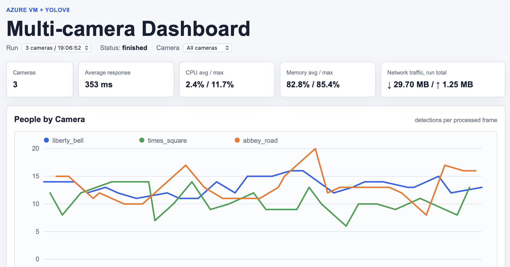
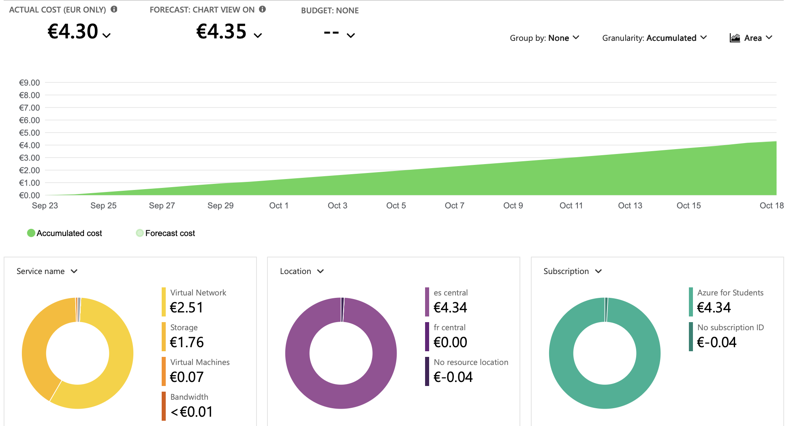

# Cloud Camera Processing on Azure

Cloud and edge computer-vision system in which public webcams act as presence sensors for a smart-lighting scenario. The project compares local YOLOv8 inference with two Azure architectures and extends them from one camera to multi-camera workloads.



## Architectures compared

1. **Local processing:** frame capture and YOLOv8 inference on the same computer.
2. **Azure VM processing:** local capture with remote inference on an Azure virtual machine.
3. **Serverless processing:** frame upload to Azure Blob Storage, event-driven Azure Function processing and Azure AI Vision inference.

Each implementation records detections and timing data and exposes a small monitoring dashboard. The experiments cover one, two and three live cameras plus VM stress tests with 5, 10 and 15 simulated cameras.

## Main findings

- local processing provided the simplest low-latency baseline;
- the VM architecture remained stable with 5 and 10 simulated cameras, while the 15-camera workload overloaded the selected VM configuration;
- the serverless design scaled the application components independently, but the Azure AI Vision F0 transaction limit caused HTTP 429 errors in the three-camera experiment;
- the project includes a cost comparison and identifies the service tier, capture interval and compute size as practical scaling constraints.



## Repository structure

```text
local 1280px/                    # local YOLOv8 baseline
multi-cameras/vm_processing/     # multi-camera Azure VM pipeline
multi-cameras/serverless/        # Blob Storage + Function + Vision pipeline
report_assets/                   # figures used in the project report
Tamara_Besedina_Cloud_Report.pdf # full methods, experiments and discussion
```

Saved `.webarchive` dashboards provide a view of the running interfaces without requiring the Azure resources.

## Run the project

Setup and execution commands are documented next to each implementation:

- [`local 1280px/RUN_COMMANDS.txt`](local%201280px/RUN_COMMANDS.txt)
- [`multi-cameras/vm_processing/RUN_COMMANDS.txt`](multi-cameras/vm_processing/RUN_COMMANDS.txt)
- [`multi-cameras/serverless/RUN_COMMANDS.txt`](multi-cameras/serverless/RUN_COMMANDS.txt)

Azure credentials and connection strings must be supplied through environment variables or Azure Function App Settings; they are not stored in the repository.

For the complete methodology and measurements, see the [project report](Tamara_Besedina_Cloud_Report.pdf).

## Tools

Python, YOLOv8, OpenCV, Azure Virtual Machines, Azure Functions, Azure Blob Storage, Azure AI Vision, JavaScript and HTML/CSS.
